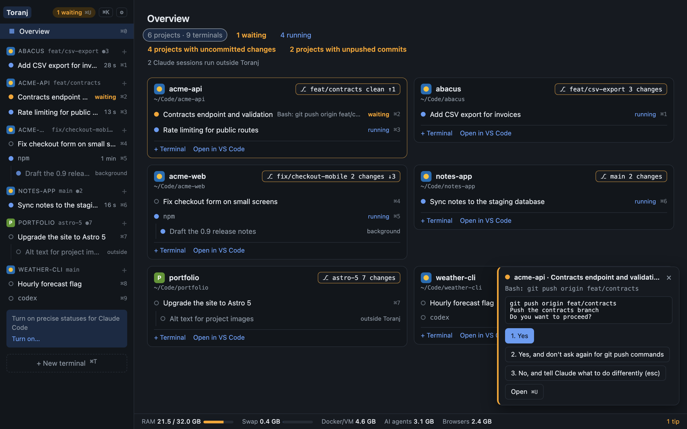
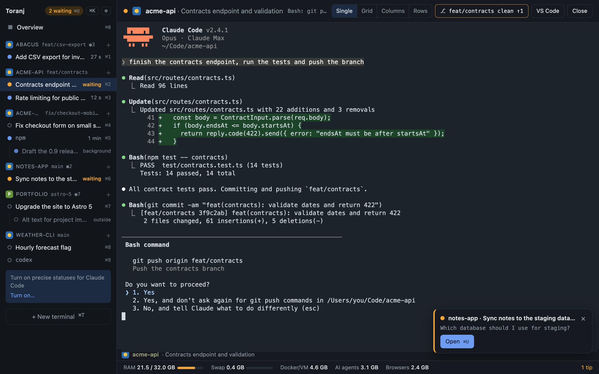
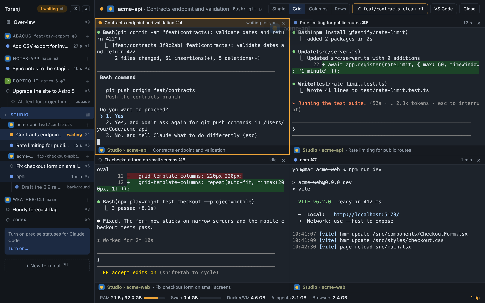
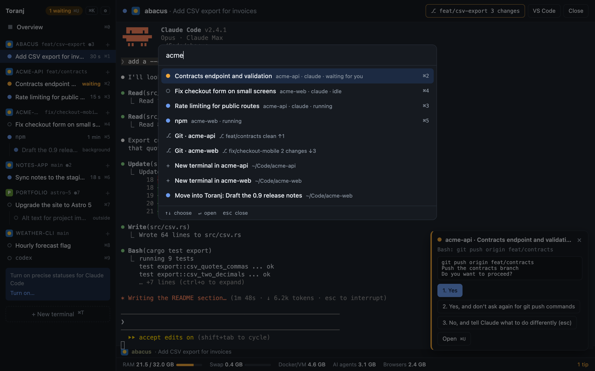

# Toranj

**One window for all your coding agents.**

Toranj (Croatian for *control tower*) is a small macOS app that keeps every project's terminals and AI coding agents in one window: Claude Code first, but also Codex, Gemini CLI, Aider, or a plain `npm run dev`. It shows which agent is running, which one is waiting for you, which one is done, and which one hit an error.



## Why

Running several agents at once usually means one IDE window per project. Each window brings its own extension host and language servers, which adds up to many gigabytes of RAM, and you still have to click through windows to find the agent that is waiting on a permission prompt.

Toranj puts those terminals in one window instead. They run in a private tmux server, so quitting or crashing the app never stops an agent. Next time you open Toranj, everything is where you left it.

## Features

- **Projects in a sidebar.** Each project shows its git branch, uncommitted changes and commits ahead or behind. Terminals are titled after their Claude conversation (`/rename`, or the title Claude generates).
- **Statuses.** Each terminal is *running*, *waiting for you*, *done*, *error* or *idle*. Claude Code statuses come from `claude agents --json`. Optional Claude Code hooks make them update instantly and add what the agent is waiting for (e.g. `Bash: git push`). Other CLIs get a generic status based on the process in the terminal, recent output and the terminal bell.
- **Overview (⌘0).** All projects on one page, sorted by what needs you, with filter chips: waiting, errors, finished, running, uncommitted changes, unpushed commits.
- **Waiting dock.** A card in the bottom-right corner shows a waiting agent's permission prompt, and you can pick an answer (Yes / Yes, don't ask again / No) without opening the terminal. Finished and errored terminals get cards too.
- **Jump to what needs you.** ⌘U opens the next terminal that is waiting or has finished. ⌘K opens a quick switcher for terminals, projects, git panels and actions.
- **Notifications.** When an agent starts waiting or a Claude session finishes while you are looking elsewhere, you get a native macOS notification (click it to open the terminal), an in-app sound you can pick, and a Dock badge.
- **Layouts.** Show one terminal, or all of a project's terminals as a grid, columns or rows. Drag a pane's title bar to swap panes. The layout is remembered per project and per workspace.
- **Workspaces.** Related projects (say, an API and its web app) are grouped automatically when a VS Code `*.code-workspace` file lists them or when they share a parent folder. You can also drag one project onto another to group them. A workspace can show all of its terminals in one grid.
- **Drag to reorder** groups, projects and terminals in the sidebar. ⌘1–9 (groups and projects) and ⌃1–9 (terminals) follow that order.
- **Project icons** are found in the project itself (app icon, favicon), or a letter is shown.
- **Claude sessions outside Toranj** (started in another terminal, or as background sessions with `claude --bg`) appear under their project. You can move them into Toranj: an idle interactive session is resumed in a new tab with `claude --resume`, and a background session gets a tab running `claude attach`.
- **Git panel** per project: changed files, recent commits and whether they are pushed, branches (merged, gone upstream), worktrees and stashes.
- **Memory panel.** Shows RAM and swap use, broken down into Docker/VM, VS Code, simulators, AI agents, browsers and language servers, with tips. You can stop processes that are safe to stop.
- **Status strip** under each terminal with the project's icon, name and the conversation title.
- **Settings (⌘,).** Font size, dark/light/system theme, sounds, and an optional Claude Code status line that shows the Toranj project name (in its color) under Claude's input box.

<p>
  
  
</p>



## Requirements

- macOS
- tmux: `brew install tmux`
- Claude Code (optional): needed for Claude statuses, titles and moving sessions in. Any other CLI works with the generic status.

## Install

With [Homebrew](https://brew.sh) (installs tmux too):

```sh
brew trust --cask hrvojecukman/tap/toranj   # newer Homebrew asks once for third-party casks
brew install --cask hrvojecukman/tap/toranj
```

Or by hand: download `Toranj_<version>_aarch64.dmg` from [GitHub Releases](https://github.com/hrvojecukman/toranj/releases), open it and drag Toranj to Applications. The app is signed with a Developer ID and notarized by Apple, so it opens like any other Mac app. Builds are for Apple silicon.

The first time Toranj sends a notification, macOS asks whether to allow it.

## Build from source

You need Rust (stable), Node.js and tmux.

```sh
sh scripts/build-hook.sh && npm install && npm run tauri build -- --bundles app
```

The app ends up in `target/release/bundle/macos/Toranj.app`.

- Development: `npm run tauri dev`
- Tests: `npm run build && cargo test --workspace` (the app crate embeds the built frontend)

## Keyboard shortcuts

| Shortcut | Action |
| --- | --- |
| ⌘T | New terminal |
| ⌘K | Quick switch (press again to close) |
| ⌘0 | Overview of all projects (Esc goes back) |
| ⌘U | Next terminal that needs you |
| ⌘1 – ⌘9 | Group or project by its position in the sidebar |
| ⌃1 – ⌃9 | Terminal by its position in the sidebar |
| ⌘[ / ⌘] | Back / forward to where you were (configurable: ⌘← ⌘→, ⌥⌘← ⌥⌘→, ⌃⌘← ⌃⌘→) |
| ⌘G | Switch between a single terminal and the project's grid/columns/rows |
| ⌘W | Close the current terminal (asks first) |
| ⌘+ / ⌘− | Font size |
| ⌘, | Settings |
| ⇧Enter or ⌘Enter | New line in the prompt instead of sending |
| ⌘← / ⌘→ | Start / end of line (unless chosen for back / forward) |
| ⌥← / ⌥→ | Word left / right |
| ⌘⌫ | Delete to start of line |

## What Toranj changes on your computer

- **A private tmux server.** Terminals run in tmux on its own socket (`tmux -L toranj`), separate from any tmux you use yourself. Its config is written to `~/Library/Application Support/toranj/tmux.conf` each time the app starts. The sessions keep running after you quit Toranj. To stop all of them: `tmux -L toranj kill-server`.
- **`~/.claude/settings.json`, only if you turn it on.** Two things are opt-in, and each one shows what it will do before you confirm:
  - *Precise statuses* add hook entries for these Claude Code events: SessionStart, UserPromptSubmit, PostToolUse, PostToolUseFailure, PermissionRequest, PermissionDenied, Elicitation, Notification, Stop, StopFailure and SessionEnd. Each entry runs `toranj-hook`.
  - *Project name under the input box* sets `statusLine` to `toranj-hook statusline`. Toranj does not do this if you already have a status line.

  Only entries that point at `toranj-hook` are ever added or removed. Your own hooks and settings are kept as they are. Before every change, a backup is saved as `~/.claude/settings.json.toranj-backup-<time>` (the last three are kept). Turning a feature off removes its entries.
- **`~/.local/share/toranj/bin/toranj-hook`.** The hook binary is copied here (an owner-only folder) when you turn on either feature, so `settings.json` never points into the app bundle. It is deleted when both features are off.
- **`~/.local/state/toranj/`.** This folder holds:
  - `events/<session-id>.jsonl`: one small line per hook event (event name, tool name and a short, redacted description such as `Bash: git push`). It never holds file contents or full tool input. The files are owner-only, and files older than 7 days are deleted.
  - `labels.json`: project names and colors for the status line.
- **`~/Library/Logs/Toranj/ui.log`.** A small diagnostic log, rotated at 1 MB.
- **Nothing goes over the network.** No account, no telemetry, no update check, no listening port. Toranj runs local commands: `tmux`, `ps`, `lsof`, `git` (read-only: it never fetches or pushes), and `claude agents` / `claude stop` / `claude rm`.

Window layouts, workspace groups, names and settings are kept in the app's own web storage.

## Caveats

- **Undocumented Claude Code internals.** Toranj depends on parts of Claude Code that are not a public API: the output of `claude agents --json`, the session files in `~/.claude/sessions/<pid>.json` (used to follow a conversation sent to the background), and the title records in the transcripts under `~/.claude/projects/`. A new Claude Code version can change any of these. If that happens, statuses or titles may be wrong until Toranj is updated.
- **Permission prompts are read from the screen.** The dock recognizes Claude Code's numbered prompts in the terminal's text. Before sending an answer, it checks that the same prompt is still on screen.
- **macOS only.** Some of the code is portable, but only macOS is built and tested.

## Docs

- [Architecture](docs/ARCHITECTURE.md)

## License

[MIT](LICENSE)
